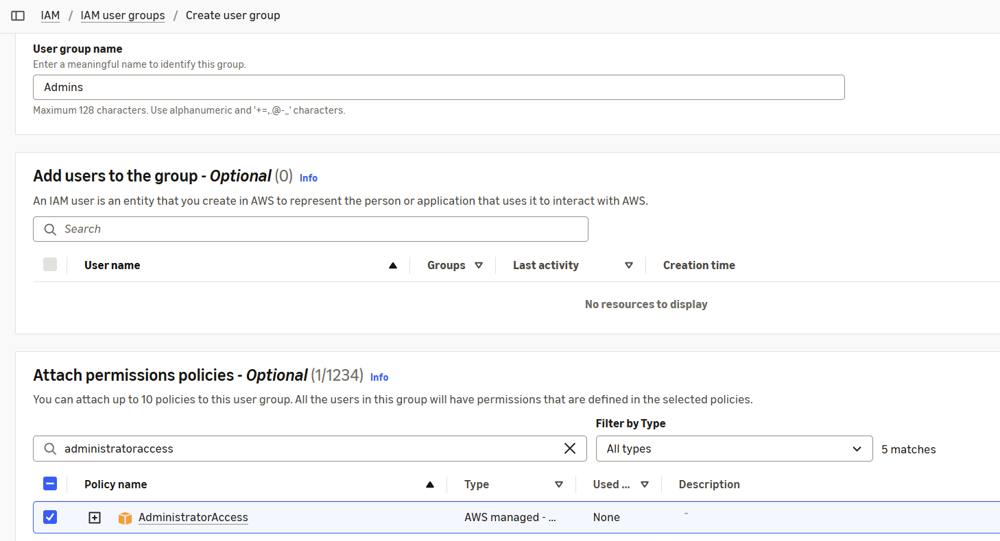
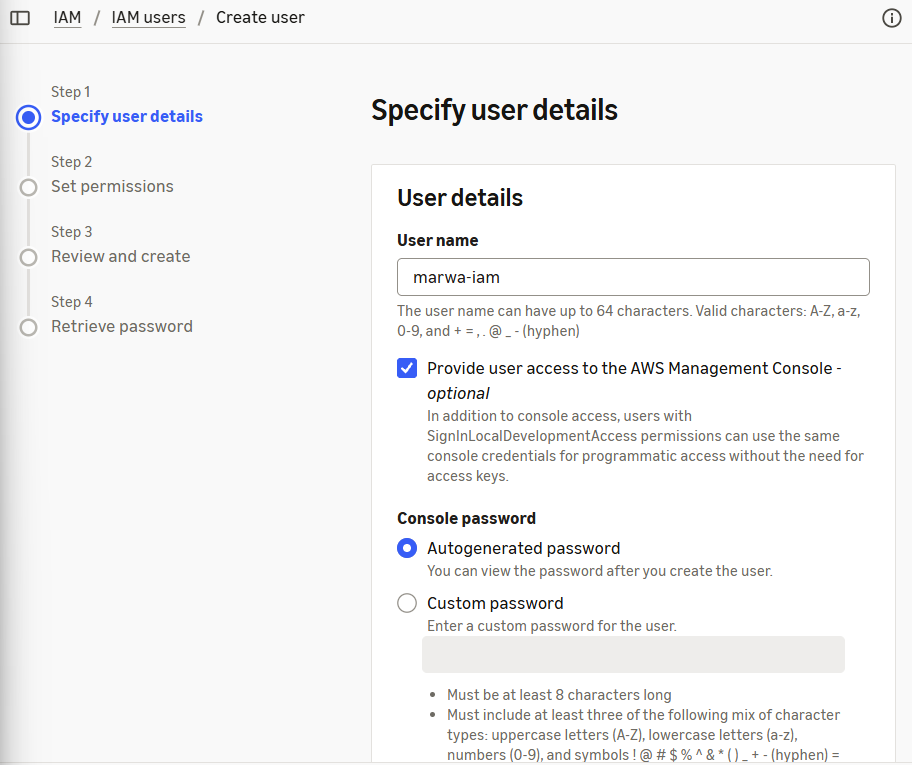
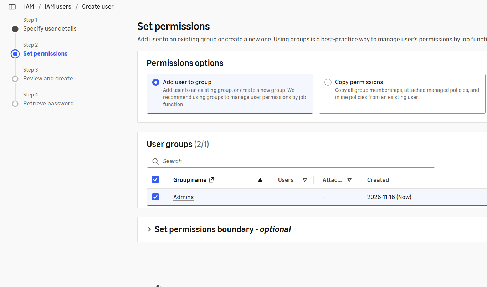
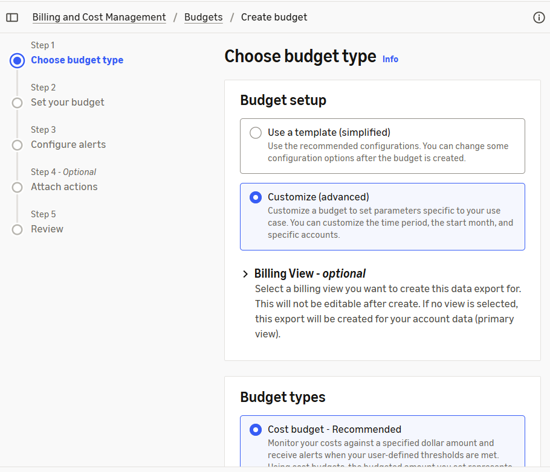
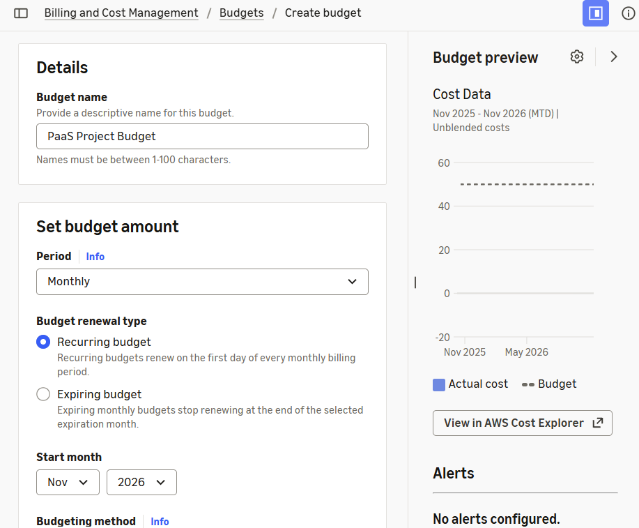
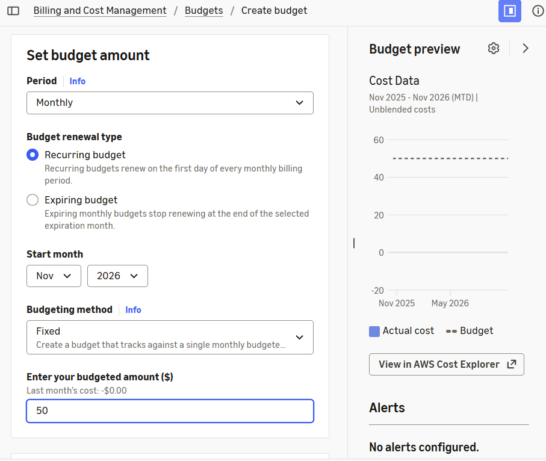
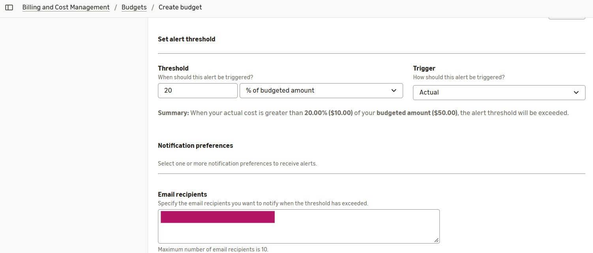
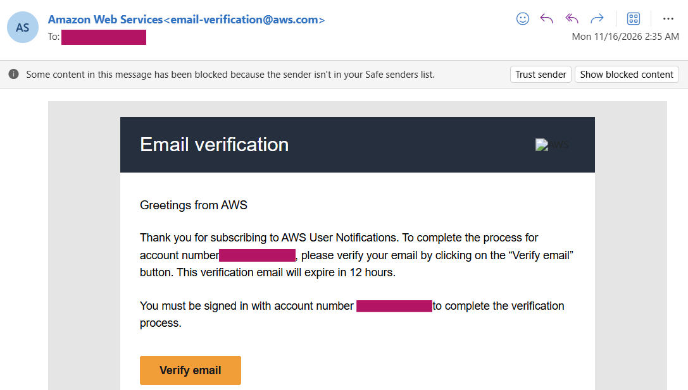
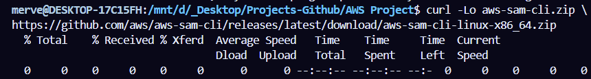

# Multi-Tenant SaaS Platform (Step #01 & Step #02)

- Pick one Region, review pricing, create AWS Budget with alerts ($10/$20/$30/$40/$50), set up an admin user with MFA (not root)
- Create the SAM project and Git repo, set naming/tagging conventions, write a cleanup checklist, sketch architecture diagram v1

A serverless, multi-tenant SaaS platform built with **Python, FastAPI, AWS Lambda, and AWS SAM**.

> **Current status:** Initial project setup and local FastAPI development completed. The application has not yet been deployed to AWS.

---

## Table of Contents

- [Project Overview](#project-overview)
- [Technology Stack](#technology-stack)
- [Project Progress](#project-progress)
- [Step 1 - AWS Account Setup](#step-1---aws-account-setup)
- [Step 2 - Development Environment and Project Initialization](#step-2---development-environment-and-project-initialization)
- [Running the Application Locally](#running-the-application-locally)

---

## Project Overview

The goal of this project is to build a multi-tenant SaaS platform using a serverless AWS architecture.

The platform will eventually support multiple organizations, with each organization having isolated data and access to its own resources.

The development approach prioritizes:

- Serverless architecture.
- Multi-tenant data isolation.
- Secure authentication and authorization.
- Infrastructure as Code using AWS SAM.
- Cost awareness and resource management.
- Local development and testing before deployment.

## Technology Stack

| Technology | Purpose |
|---|---|
| Python 3.12 | Backend development |
| FastAPI | REST API framework |
| Mangum | ASGI adapter for AWS Lambda |
| AWS SAM | Serverless application development |
| AWS Lambda | Serverless compute |
| Amazon API Gateway | API management |
| Docker Desktop | Local Lambda container execution |
| WSL2 / Ubuntu | Linux development environment |
| Git | Version control |
| Amazon DynamoDB | Planned database |
| Amazon Cognito | Planned authentication |

---

## Project Progress

| Milestone | Status |
|---|---|
| AWS account preparation | Completed |
| IAM administrator and MFA setup | Completed |
| AWS Budget configuration | Completed |
| AWS SAM CLI installation | Completed |
| WSL2 and Docker configuration | Completed |
| SAM project initialization | Completed |
| FastAPI and Mangum integration | Completed |
| SAM template configuration | Completed |
| Local API testing | Completed |
| DynamoDB integration | Upcoming |
| Cognito authentication | Upcoming |
| AWS deployment | Upcoming |

---

# Step 1 - AWS Account Setup

The first step was preparing the AWS environment while keeping cost management and account security in mind.

### 1. AWS Region Selection and Pricing Review

Selected an AWS region for the project and reviewed the relevant AWS service pricing before creating resources.

### 2. IAM Administrator User Creation

Created a dedicated IAM administrator user instead of using the AWS root account for everyday development activities.

The administrator account is intended for project-related AWS management.

**Screenshots:**







### 3. Multi-Factor Authentication (MFA)

Configured MFA for the administrator account to add an additional layer of account security.

### 4. AWS Budget and Cost Alerts

Created an AWS Budget to monitor project spending and receive notifications at the following thresholds:

| Alert Threshold |
|---|
| $10 |
| $20 |
| $30 |
| $40 |
| $50 |

These alerts help monitor AWS spending during development and identify unexpected costs early.

**Screenshots:**











### Step 1 Output

- AWS account prepared for development.
- Dedicated IAM administrator created.
- MFA configured.
- AWS Budget created with spending alerts.

---

# Step 2 - Development Environment and Project Initialization

The second step focused on preparing the local development environment and creating the initial serverless application.

## 1. Development Environment

The application is developed locally using WSL2 with Ubuntu on Windows.

The environment consists of:

- WSL2 with Ubuntu.
- Docker Desktop with WSL integration enabled.
- Python 3.12.
- AWS SAM CLI.
- Git.

Install the required Linux packages:

```bash
sudo apt update && sudo apt upgrade -y

sudo apt install -y curl unzip git python3 python3-pip python3-venv
```

Verify Docker is accessible:

```bash
docker --version
docker ps
```

## 2. AWS SAM CLI Installation

Check the system architecture:

```bash
uname -m
```

For x86_64:

```bash
curl -Lo aws-sam-cli.zip \
https://github.com/aws/aws-sam-cli/releases/latest/download/aws-sam-cli-linux-x86_64.zip

unzip aws-sam-cli.zip -d sam-installation

sudo ./sam-installation/install

sam --version
```

For ARM64 systems (`aarch64`), use the `aws-sam-cli-linux-arm64.zip` package.

**Installation screenshot:**



## 3. Initialize the SAM Project

Created the project inside the Linux filesystem to avoid Docker mount and permission issues.

```bash
mkdir -p ~/projects && cd ~/projects

sam init \
  --name sam-fastapi \
  --runtime python3.12 \
  --app-template hello-world \
  --package-type Zip

cd sam-fastapi
```

Created a Python virtual environment:

```bash
python3 -m venv .venv

source .venv/bin/activate
```

## 4. FastAPI and Mangum Integration

Replaced the default SAM Hello World application with FastAPI.

**File:** `hello_world/app.py`

```python
from fastapi import FastAPI
from mangum import Mangum

app = FastAPI(
    title="Multi-Tenant SaaS API",
    description="Serverless SaaS platform API",
    version="1.0.0",
)

@app.get("/")
async def root():
    return {"message": "Welcome to the SaaS platform"}

@app.get("/health")
async def health():
    return {"status": "healthy"}

handler = Mangum(app)
```

**File:** `hello_world/requirements.txt`

```text
fastapi
mangum
```

FastAPI provides the API framework, while Mangum adapts the ASGI application to work with AWS Lambda.

## 5. AWS SAM Template Configuration

Updated `template.yaml` to configure the Lambda function and API Gateway events.

```yaml
AWSTemplateFormatVersion: '2010-09-09'
Transform: AWS::Serverless-2016-10-31
Description: Multi-Tenant SaaS API

Globals:
  Function:
    Timeout: 30
    MemorySize: 512
    Runtime: python3.12
    Architectures:
      - x86_64
    LoggingConfig:
      LogFormat: JSON

Resources:
  FastApiFunction:
    Type: AWS::Serverless::Function
    Properties:
      CodeUri: hello_world/
      Handler: app.handler
      Events:
        RootApi:
          Type: Api
          Properties:
            Path: /
            Method: ANY
        ProxyApi:
          Type: Api
          Properties:
            Path: /{proxy+}
            Method: ANY

Outputs:
  ApiUrl:
    Description: API Gateway endpoint URL
    Value: !Sub "https://${ServerlessRestApi}.execute-api.${AWS::Region}.${AWS::URLSuffix}/Prod/"
```

The API Gateway events connect incoming HTTP requests to the Lambda function.

X-Ray tracing is intentionally not enabled at this stage to keep the initial configuration simple and avoid unnecessary costs.

## 6. Validate and Build the Application

From the project root, run:

```bash
sam validate
```

Build the application:

```bash
sam build
```

The build process packages the application and its dependencies into the `.aws-sam/build` directory.

**Expected result:**

```text
Build Succeeded
```

Run `sam build` again whenever application code or dependencies change.

## 7. Run the API Locally

Start the local API:

```bash
sam local start-api
```

Expected output:

```text
Mounting FastApiFunction at http://127.0.0.1:3000/ [DELETE, GET, HEAD, OPTIONS, PATCH, POST, PUT]

Mounting FastApiFunction at http://127.0.0.1:3000/{proxy+} [DELETE, GET, HEAD, OPTIONS, PATCH, POST, PUT]
```

SAM uses Docker to run the Lambda function locally.

Keep this terminal running while testing the API.

## 8. Test the API

Open a second WSL terminal.

Test the root endpoint:

```bash
curl http://localhost:3000/
```

Expected response:

```json
{
  "message": "Welcome to the SaaS platform"
}
```

Test the health endpoint:

```bash
curl http://localhost:3000/health
```

Expected response:

```json
{
  "status": "healthy"
}
```

### Swagger Documentation

FastAPI automatically generates interactive API documentation.

Open the following URL in your browser:

http://localhost:3000/docs

This provides the Swagger UI for viewing and testing the available endpoints.

### Step 2 Output

- WSL2 and Docker configured.
- AWS SAM CLI installed.
- SAM project initialized.
- FastAPI integrated with Mangum.
- Lambda function and API Gateway events configured.
- Application validated and built.
- Local API successfully tested.

---

# Running the Application Locally

To run the project from scratch:

**1. Navigate to the project directory:**

```bash
cd ~/projects/sam-fastapi
```

**2. Activate the virtual environment:**

```bash
source .venv/bin/activate
```

**3. Build the application:**

```bash
sam build
```

**4. Start the local API:**

```bash
sam local start-api
```

**5. Access the application:**

| Resource | URL |
|---|---|
| Root endpoint | http://localhost:3000/ |
| Health endpoint | http://localhost:3000/health |
| Swagger UI | http://localhost:3000/docs |

---

## API Endpoints

| Method | Endpoint | Description |
|---|---|---|
| GET | `/` | Returns a welcome message |
| GET | `/health` | Returns application health status |

These are the initial endpoints. Additional functionality will be introduced as the SaaS platform develops.

---

## Project Structure

Current initial project structure:

```text
sam-fastapi/
│
├── .aws-sam/
│   └── build/
│
├── .venv/
│
├── hello_world/
│   ├── app.py
│   └── requirements.txt
│
├── template.yaml
├── samconfig.toml
└── README.md
```

Additional directories and files will be introduced as the application grows.

---

## Architecture

The current implementation is a local serverless development environment.

```text
Developer
    |
    v
WSL2 (Ubuntu)
    |
    +------------------+
    |                  |
    v                  v
 AWS SAM CLI       Docker Desktop
    |                  |
    +--------+---------+
             |
             v
      SAM Local API
      localhost:3000
             |
             v
       API Gateway
        (Local)
             |
             v
       AWS Lambda
        (Local)
             |
             v
      FastAPI + Mangum
             |
       +-----+------+
       |            |
       v            v
     GET /       GET /health
```

---