# Multi-Tenant Project and Task Management ( Step #05 & Step #06 )

- Basic project/task CRUD, request validation, CloudWatch logging with short retention
- Frontend on S3 + CloudFront (login, list projects), deploy end to end

## 1. Implement Project and Task Management

### Project Management

The Projects API provides the following operations:

| Method | Endpoint | Description | Allowed Roles |
|---|---|---|---|
| POST | `/projects` | Create a new project | admin, member |
| GET | `/projects` | Retrieve the list of projects | All authenticated users |
| GET | `/projects/{id}` | Retrieve a specific project | All authenticated users |
| PATCH | `/projects/{id}` | Update an existing project | admin, member |
| DELETE | `/projects/{id}` | Delete a project | admin |

An additional validation rule was implemented for project deletion: a project cannot be deleted while it still contains tasks. In this situation, the API returns `409 Conflict`.

### Task Management

The same CRUD functionality was implemented for tasks.

Tasks are associated with their corresponding projects, allowing the application to organize work within individual projects.

The main endpoints include:

| Method | Endpoint | Description | Allowed Roles |
|---|---|---|---|
| POST | `/projects/{id}/tasks` | Create a task within a project | admin, member |
| GET | `/projects/{id}/tasks` | List tasks belonging to a project | All authenticated users |
| GET | `/tasks/{taskId}` | Retrieve a specific task | All authenticated users |
| PATCH | `/tasks/{taskId}` | Update an existing task | admin, member |
| DELETE | `/tasks/{taskId}` | Delete a task | admin |

### Request Validation and Logging

Request validation was implemented to ensure that incoming API requests contain the expected data and follow the defined application models.

CloudWatch logging was also configured to monitor API activity and support application monitoring.

The API access log group uses a short retention period of seven days to keep development logging costs under control.

### Role-Based Access Control

The application uses Cognito groups to distinguish between different user roles.

The main roles are:

- **Admin:** Can create, view, update, and delete resources.
- **Member:** Can create, view, and update resources.
- **Viewer:** Can view resources without modifying them.

---

## 2. Implement the Frontend User Interface

After completing the main backend functionality, the next step was developing a frontend that allows users to interact with the platform through a graphical interface.

The frontend follows the Kanso design theme, using:

- A dark olive sidebar.
- A warm off-white background.
- Cream-colored cards.
- Sage green accents.
- A clean dashboard layout.

The frontend was implemented using HTML, CSS, and JavaScript.

Although the backend uses Python and FastAPI, JavaScript is used for the frontend because it runs directly in the user's browser. The frontend communicates with the FastAPI backend through HTTP requests.

The application follows this architecture:

```text
User Browser
     |
     v
HTML + CSS + JavaScript
     |
     v
Amazon CloudFront
     |
     v
Amazon S3
(Static Frontend Hosting)

     |
     | HTTPS API Requests
     v
API Gateway HTTP API
     |
     v
Cognito JWT Authorizer
     |
     v
AWS Lambda
(FastAPI Backend)
     |
     v
Amazon DynamoDB
```

### 2.1 Authentication Page

The first screen is the sign-in page.

Users authenticate using their Cognito credentials. The frontend sends the authentication request to Cognito and receives the authentication tokens.

The application uses the token to authenticate subsequent API requests.

The session token is stored in `sessionStorage`, meaning the session is cleared when the browser tab is closed.

The login interface also displays an error message when the user enters incorrect credentials.

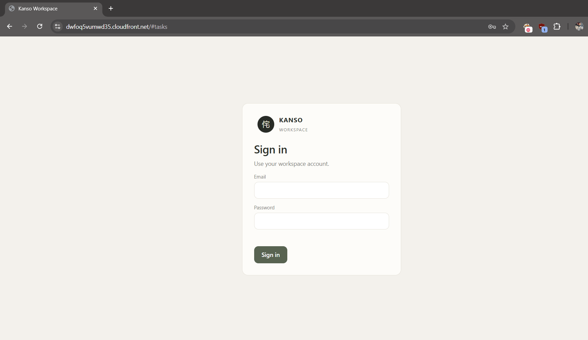

### 2.2 Overview Dashboard

After successful authentication, users are redirected to the Overview dashboard.

The dashboard provides a summary of the current workspace, including:

- Total number of projects.
- Total number of tasks.
- Project progress.
- Recently created tasks.

The dashboard retrieves information from the backend APIs rather than relying on static sample data.

This provides users with an overview of their current project activity.

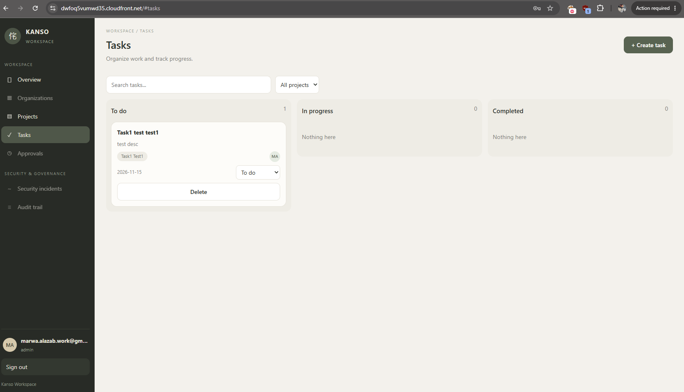

### 2.3 Projects Page

The Projects page displays the projects available to the authenticated user.

Each project is presented as a card containing information such as:

- Project name.
- Project description.
- Project status.
- Task completion progress.

The progress bar represents the percentage of tasks marked as completed within the project.

Users with the appropriate permissions can create new projects through the **New Project** button.

The creation form sends the project information to the FastAPI backend, where it is validated and stored in DynamoDB.

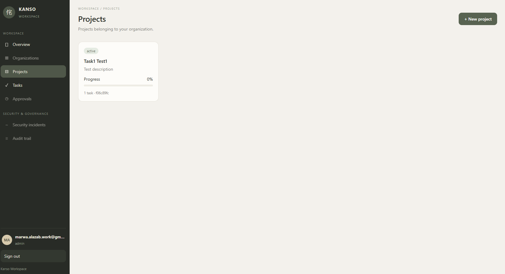

### 2.4 Tasks Management Board

The Tasks page provides an interface for managing tasks across projects.

Tasks are organized into three columns according to their status:

- To Do
- In Progress
- Completed

The interface also includes:

- Task search.
- Project filtering.
- Task creation.
- Task status updates.
- Task details.

Users can create tasks through the **Create Task** modal and associate them with an existing project.

Task status can also be changed directly from the task card.

All modifications are sent to the backend and persisted in DynamoDB.

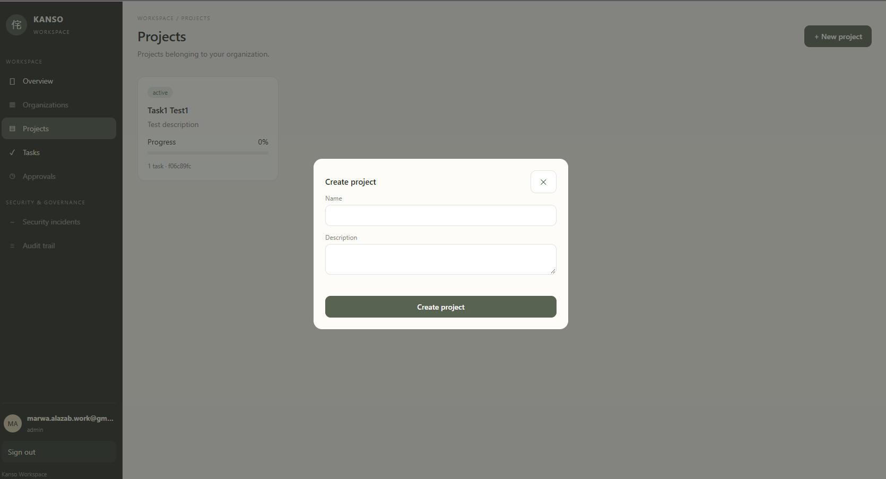

### 2.5 Role-Based Frontend Permissions

The frontend adapts its available actions according to the authenticated user's role.

For example:

- Viewers can browse projects and tasks but cannot create or modify them.
- Members can create and update projects and tasks.
- Admins have additional administrative permissions, including resource deletion.

The frontend hides actions that are not available to the current role.

However, the backend remains responsible for enforcing authorization, ensuring that the actual API operations are protected.

### 2.6 Additional Interface Sections

The navigation also includes sections for:

- Organizations
- Approvals
- Security Incidents
- Audit Trail

These sections are currently displayed as navigation placeholders and are not implemented as functional modules.

The implemented frontend functionality focuses on authentication, the Overview dashboard, Projects, and Tasks.

---

## 3. Deploy the Frontend Using Amazon S3 and CloudFront

Once the frontend was developed, the next step was integrating it into the existing AWS infrastructure.

Instead of running a separate frontend server, the application uses Amazon S3 to store static website files and Amazon CloudFront to distribute them to users over HTTPS.

### 3.1 Amazon S3

An S3 bucket was added to the SAM template to store the frontend files.

The bucket is configured with:

- Private access.
- Public access blocked.
- Server-side encryption.
- CloudFront access through Origin Access Control (OAC).

This ensures that users access the website through CloudFront rather than directly accessing the S3 bucket.

### 3.2 Amazon CloudFront

A CloudFront distribution was configured to serve the frontend.

CloudFront provides:

- HTTPS access to the application.
- Content delivery through its edge locations.
- Caching of static frontend files.
- Secure access to the private S3 bucket through Origin Access Control.

The frontend is therefore accessible through a CloudFront URL without requiring an independently running web server.

### 3.3 Configure Frontend and API Communication

The frontend needs the API Gateway URL and Cognito User Pool Client ID to communicate with the backend.

These values are retrieved from CloudFormation stack outputs and written into a `config.json` file during deployment.

This avoids hardcoding environment-specific resource IDs inside the frontend source code.

The configuration contains:

- API URL.
- Cognito User Pool Client ID.
- AWS Region.

CORS was also configured on the HTTP API to allow requests originating from the deployed CloudFront website.

### 3.4 Frontend Deployment Script

A deployment script was created at:

`scripts/deploy-frontend.sh`

The script automates the frontend deployment process.

Its main responsibilities are:

1. Retrieve the S3 bucket name and CloudFront distribution ID from CloudFormation outputs.
2. Retrieve the API URL and Cognito Client ID.
3. Generate the frontend `config.json` file.
4. Synchronize the frontend files with the S3 bucket.
5. Remove outdated files from the bucket.
6. Create a CloudFront cache invalidation.
7. Display the deployed website URL.

This makes frontend deployment repeatable without manually uploading files through the AWS Console.

### 3.5 Deploy the Infrastructure

After updating `template.yaml`, the infrastructure can be validated, built, and deployed using:

```bash
sam validate --lint
sam build
sam deploy
```

Once the infrastructure deployment is complete, upload the frontend:

```bash
chmod +x scripts/deploy-frontend.sh

./scripts/deploy-frontend.sh
```

The script generates the configuration file, uploads the website, and refreshes the CloudFront cache.

---

## 4. Test the Application End to End

The final part of this implementation is verifying that the frontend, authentication system, API Gateway, FastAPI backend, and DynamoDB work together.

The application is tested using the deployed CloudFront URL.

The following operations are verified:

1. Open the website through HTTPS.
2. Sign in using a valid Cognito test user.
3. Confirm that successful authentication redirects the user to the Overview dashboard.
4. Try signing in with an incorrect password and verify that an authentication error is displayed.
5. Open the Projects page and create a new project.
6. Refresh the page and confirm that the project remains available.
7. Open the Tasks page and create a task associated with the project.
8. Change the task status and verify that the update is persisted.
9. Sign in using a viewer-role account and confirm that modification actions are unavailable.
10. Verify that the application continues to enforce permissions through the backend APIs.

### Frontend Deployment and Implementation Screenshots

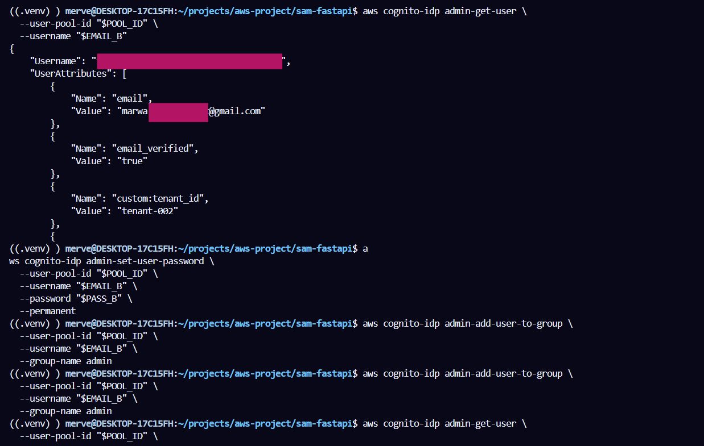

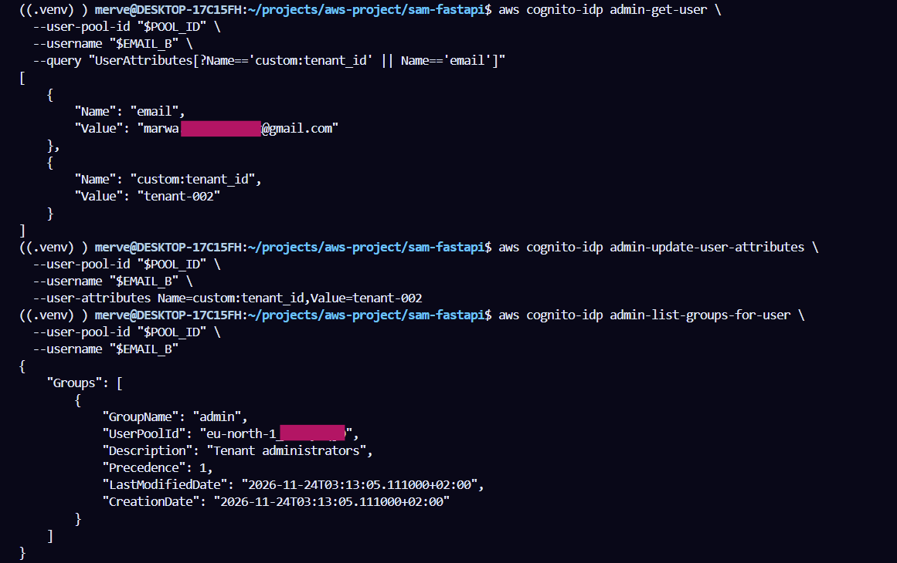

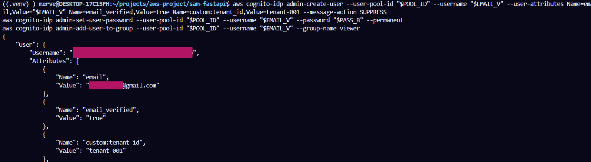

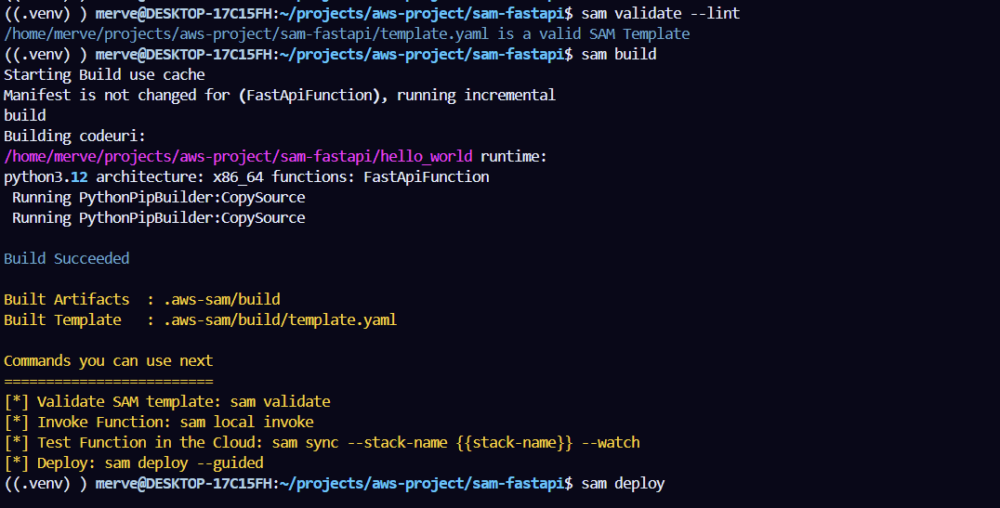

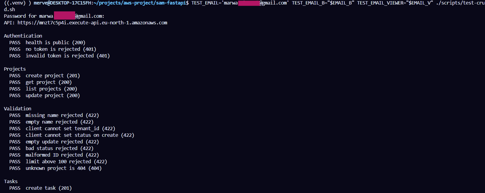

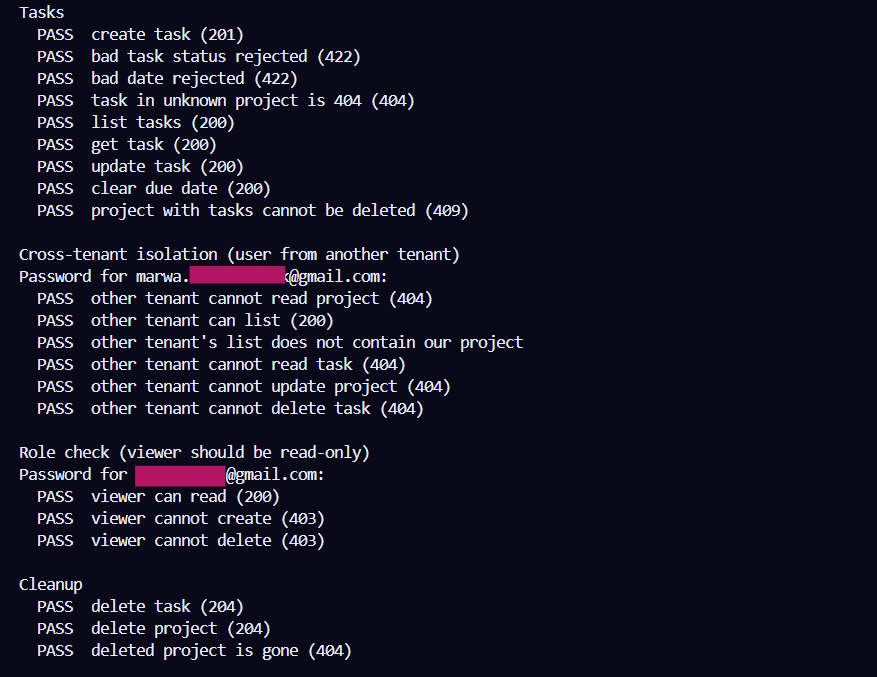


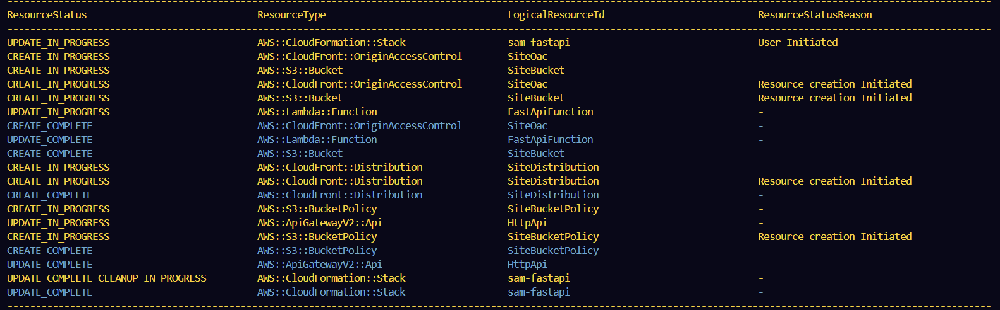

### Frontend Screenshots


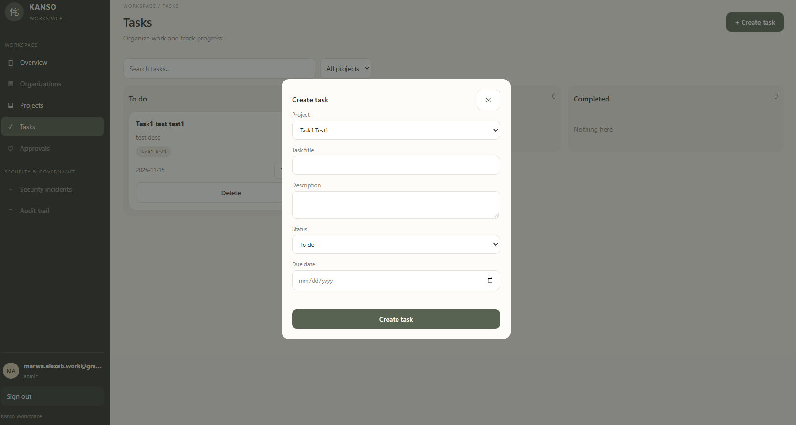

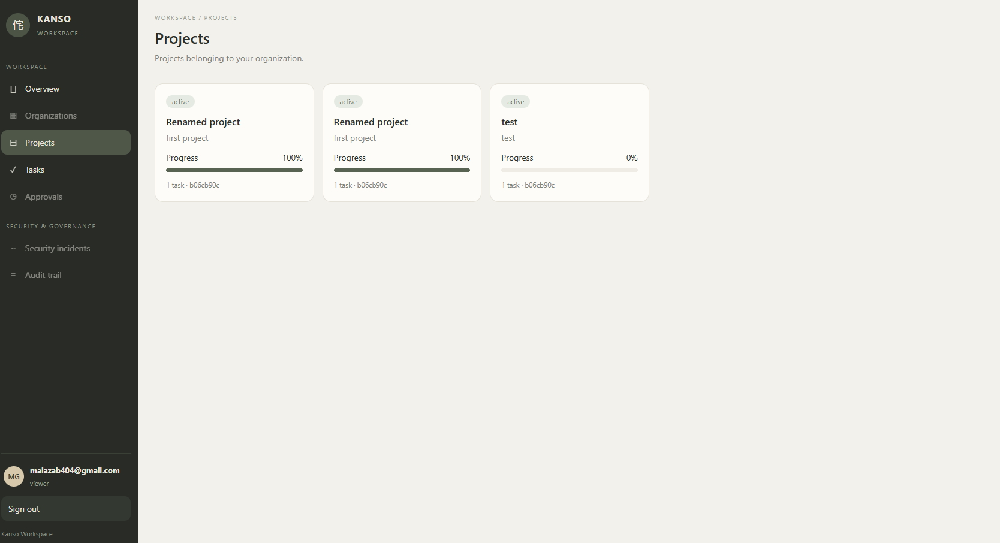

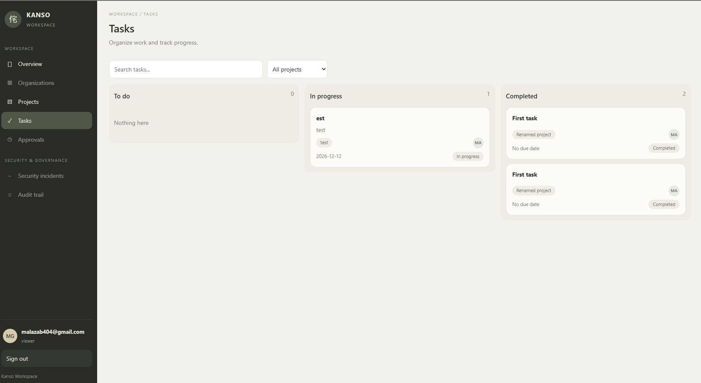

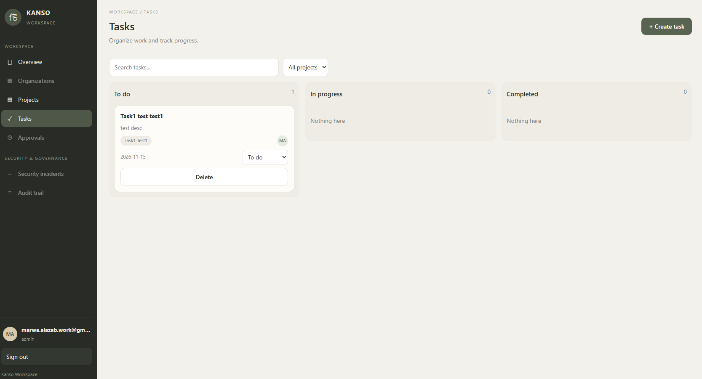

---

