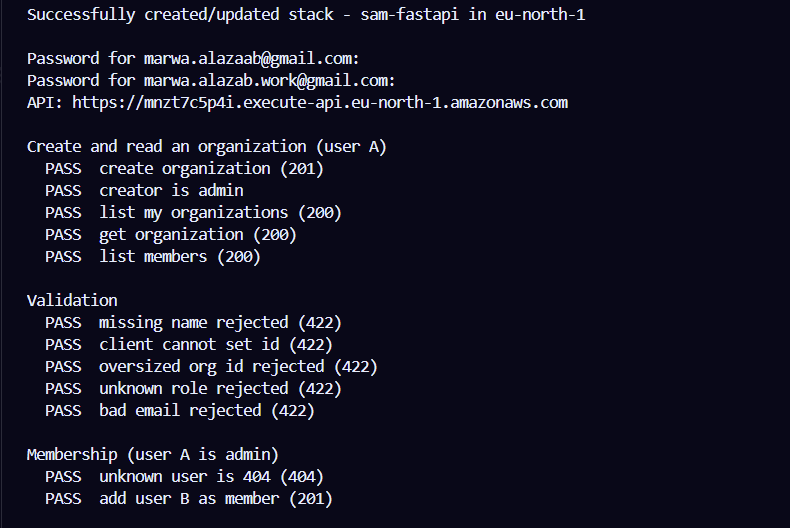
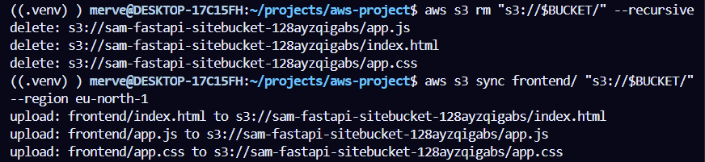

- Organization and membership model, roles (admin, member, reviewer)
- Shared authorization helper that looks up membership server-side and never trusts a client tenant ID; apply it to every endpoint

Endpoints:
Path	Who
POST	/orgs	any signed-in user (becomes admin)
GET	/orgs	your organizations with your role
GET, PATCH, DELETE	/orgs/{org_id}	read: any member. Rename and delete: admin
GET	/orgs/{org_id}/members	any member
POST	/orgs/{org_id}/members	admin, add by email with a role
PATCH	/orgs/{org_id}/members/{user_id}	admin, change role
DELETE	/orgs/{org_id}/members/{user_id}	admin removes anyone. Any member can leave





after the restructure of the project the frontend s3 needed to be deleted to be able to upload the new version 


```
 aws cloudformation describe-stacks \
  --stack-name sam-fastapi \
  --region eu-north-1 \
  --query "Stacks[0].Outputs"
```
this command returned the required values to delete the s3 

Delete commands
```
aws s3 sync frontend/ s3://YOUR_BUCKET --delete --region eu-north-1
```

```
aws cloudfront create-invalidation \
  --distribution-id YOUR_DISTRIBUTION_ID \
  --paths "/*"
```



```
 aws s3 rm "s3://$BUCKET/" --recursive
```

```
aws s3 sync frontend/ "s3://$BUCKET/" --region eu-north-1
```