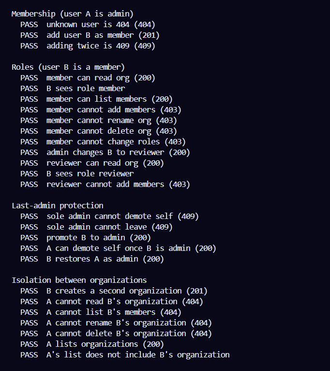
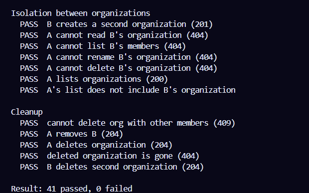
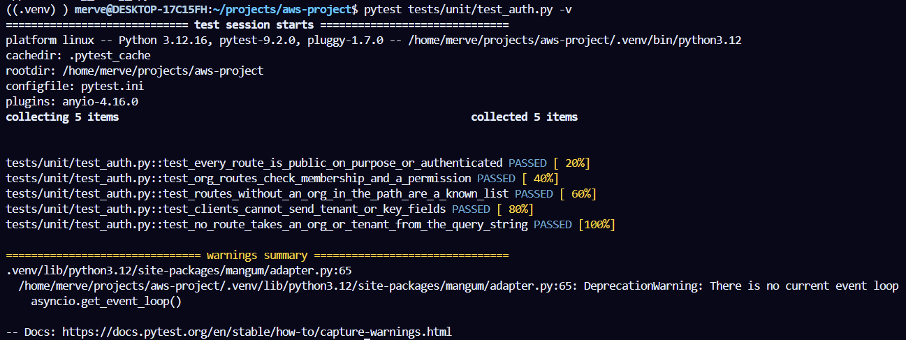
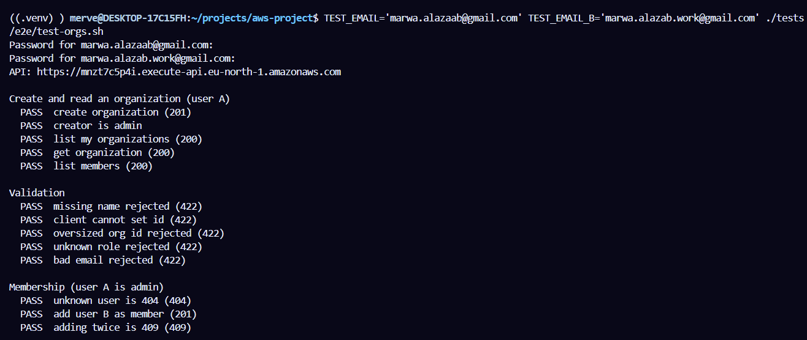
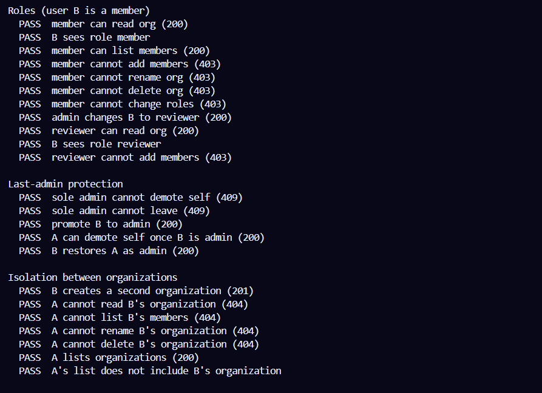
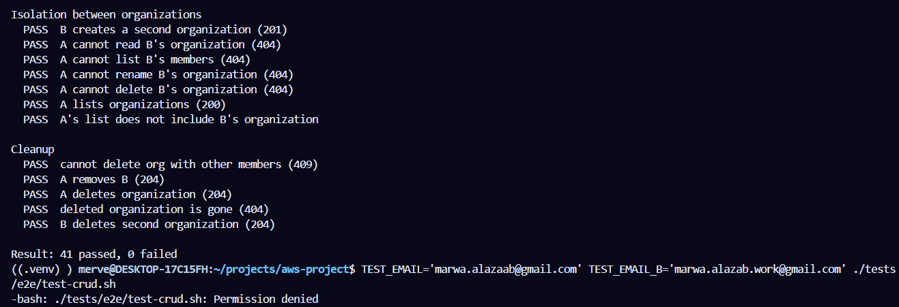

## Organization and Membership Management

- Organization and membership model, roles (admin, member, reviewer)
- Shared authorization helper that looks up membership server-side and never trusts a client tenant ID; apply it to every endpoint

Three roles were introduced:

- **Admin:** Has permission to manage the organization and its members, including renaming or deleting the organization, inviting members, changing their roles, and removing them.
- **Member:** Can access the organization and view its members. Members can also leave an organization themselves.
- **Reviewer:** A separate membership role within the organization.

### Server-Side Authorization

A shared authorization helper was implemented to handle organization membership and permission checks.

Instead of relying on an organization ID (`tenant ID`) supplied by the client, the helper looks up the user's membership on the server side. This ensures that access decisions are based on the authenticated user's actual membership and role.

The authorization helper is applied across the endpoints so that organization access and permitted actions are checked consistently. This prevents a client from gaining access to another organization's data simply by changing an organization ID in a request.

### Organization and Membership API Endpoints

The following endpoints were implemented to manage organizations and their memberships:

| Method | Endpoint | Access permissions and functionality |
|---|---|---|
| POST | `/orgs` | Any signed-in user can create an organization. The creator automatically becomes its admin. |
| GET | `/orgs` | Returns the organizations the signed-in user belongs to, together with their role in each organization. |
| GET | `/orgs/{org_id}` | Any member of the organization can view its details. |
| PATCH | `/orgs/{org_id}` | Only an admin can rename the organization. |
| DELETE | `/orgs/{org_id}` | Only an admin can delete the organization. |
| GET | `/orgs/{org_id}/members` | Any member can view the organization's membership list. |
| POST | `/orgs/{org_id}/members` | An admin can add a member using their email address and assign that member a role. |
| PATCH | `/orgs/{org_id}/members/{user_id}` | An admin can change the role assigned to a member. |
| DELETE | `/orgs/{org_id}/members/{user_id}` | An admin can remove a member. A member can also use this operation to leave the organization themselves. |

### Testing Organization and Membership Operations

After implementing the organization and membership endpoints, CRUD operations were tested to check that organizations and their members could be managed through the API.

The following screenshots show the results of these tests:






## Frontend S3 Bucket Update After Project Restructuring

After restructuring the project, the frontend deployment needed to be updated. The existing frontend files in the S3 bucket had to be removed so that the new version could be uploaded without leaving outdated files behind.

First, the CloudFormation stack outputs were retrieved to obtain the deployment values required for the S3 and CloudFront operations.

```bash
aws cloudformation describe-stacks \
  --stack-name sam-fastapi \
  --region eu-north-1 \
  --query "Stacks[0].Outputs"
```

This command returned the stack outputs, including the values needed to identify the frontend S3 bucket and CloudFront distribution.

### Updating the Frontend Files

The existing frontend files were synchronized with the contents of the local `frontend/` directory. The `--delete` option removes files from the bucket that are no longer present in the local directory.

```bash
aws s3 sync frontend/ s3://YOUR_BUCKET --delete --region eu-north-1
```

After updating the S3 bucket, a CloudFront invalidation was created to clear the cached frontend files. This ensures that users receive the updated version rather than previously cached content.

```bash
aws cloudfront create-invalidation \
  --distribution-id YOUR_DISTRIBUTION_ID \
  --paths "/*"
```

The following screenshot shows the S3 update process:


### Removing the Existing Frontend and Uploading the New Version

The existing contents of the S3 bucket were then removed recursively:

```bash
aws s3 rm "s3://$BUCKET/" --recursive
```

Once the bucket was cleared, the restructured frontend was uploaded:

```bash
aws s3 sync frontend/ "s3://$BUCKET/" --region eu-north-1
```

This replaced the previous frontend files with the new project version.

## Authentication and Organization Testing

After updating the frontend and implementing the organization functionality, authentication and organization-related operations were tested again.

The authentication test script was used to verify the authentication flow:



The organization tests were then executed to check the updated organization functionality:





Finally, permission checks were performed to verify that the organization endpoints enforced the expected access rules for different membership roles.

