## Tenant-Scoped Tasks and Approval Workflow

- Tenant-scoped tasks, conditional writes, ownership checks before update/delete
- Approval workflow state machine (Draft → Submitted → Approved/Changes Requested), reviewer-only transitions, comments

### Tenant-Scoped Tasks and Access Guards

Task operations are restricted to the tenant associated with the authenticated user. This ensures that users can only access tasks belonging to their own tenant and cannot interact with tasks from another tenant.

Additional safeguards were implemented for task updates and deletions:

- **Tenant isolation:** Task access is restricted to the correct tenant.
- **Ownership checks:** Before allowing an update or deletion, the system verifies that the user has permission to perform the operation on the specific task.
- **Conditional writes:** Write operations use conditions to ensure that changes are only applied when the required conditions are satisfied.

These guards provide an additional layer of protection around task operations and help prevent unauthorized changes or deletion of task data.

### Approval Workflow

An approval workflow was introduced to manage the review process. Each item follows a defined sequence of states:

**Draft → Submitted → Approved / Changes Requested**

The workflow controls how an item moves between these states:

- **Draft:** The item is being prepared and has not yet been submitted for review.
- **Submitted:** The item has been submitted and is awaiting review.
- **Approved:** The reviewer has approved the submitted item.
- **Changes Requested:** The reviewer has requested modifications before the item can be approved.

Only users with the reviewer role are permitted to perform the reviewer-only workflow transitions. Comments are also supported as part of the approval process, allowing feedback to be recorded during review.

Side notes: password reset 
POOL=$(aws cloudformation describe-stacks --stack-name sam-fastapi \
  --query "Stacks[0].Outputs[?OutputKey=='UserPoolId'].OutputValue" --output text)
EMAIL='xxxxx@gmail.com'

read -rsp "New password (12+ chars, upper, lower, number, symbol): " PW; echo
aws cognito-idp admin-set-user-password --user-pool-id "$POOL" \
  --username "$EMAIL" --password "$PW" --permanent
unset PW

### Frontend Screens 

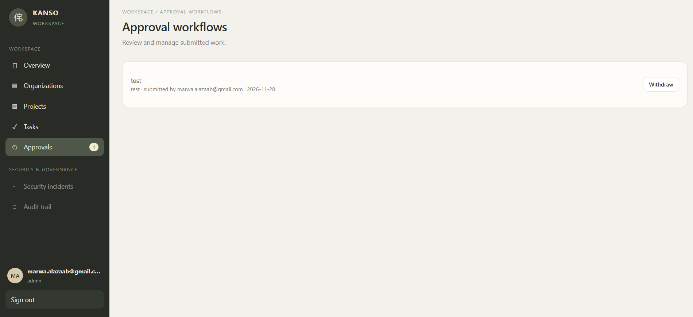

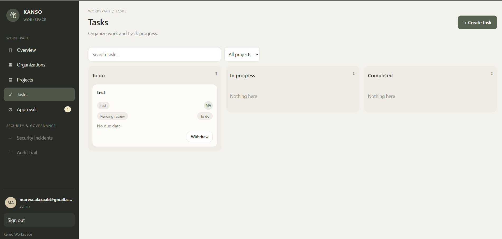
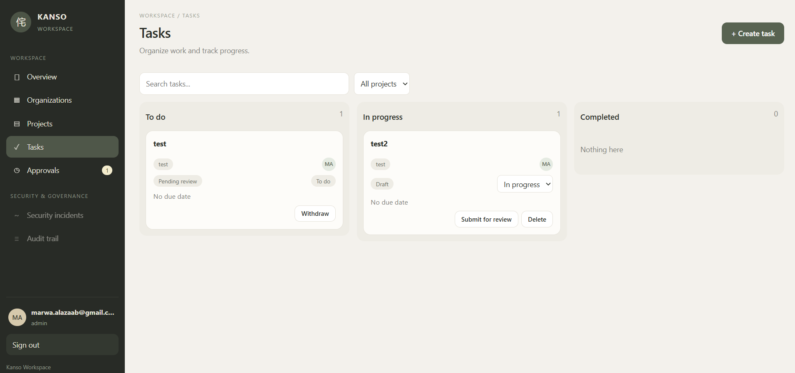
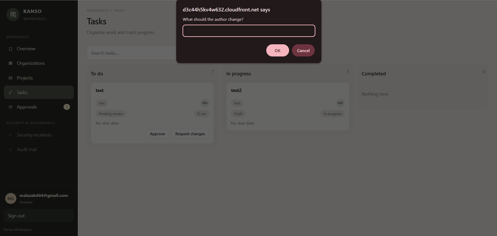
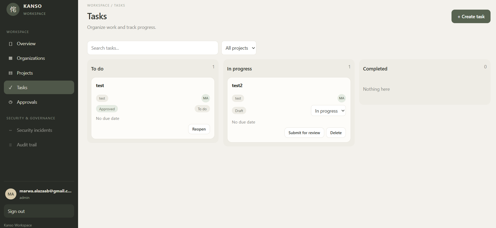

### Permissions and Workflow Guards

Additional permission checks were implemented to ensure that users can only perform actions allowed by their role and the current workflow state.

The guards cover the approval process as well as the existing task permissions. This ensures that workflow transitions are controlled rather than allowing users to change an item's status freely.

### Testing

Test scripts were added to verify the implemented functionality, including tenant-scoped task access, ownership checks, conditional writes, workflow transitions, and permission enforcement.

The following screenshots show the test cases and their results:

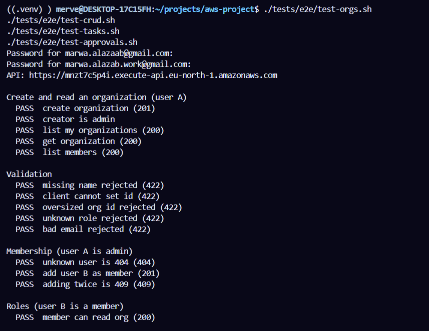

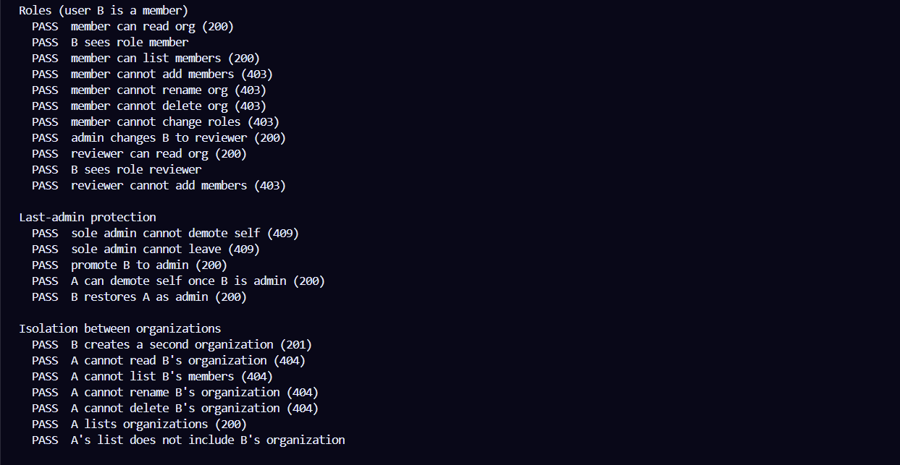

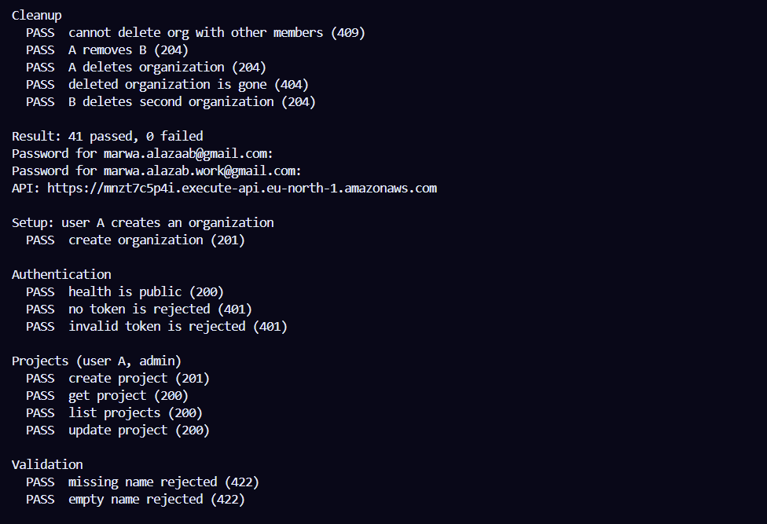

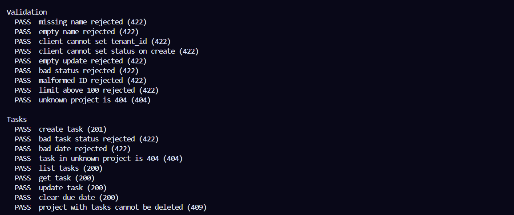

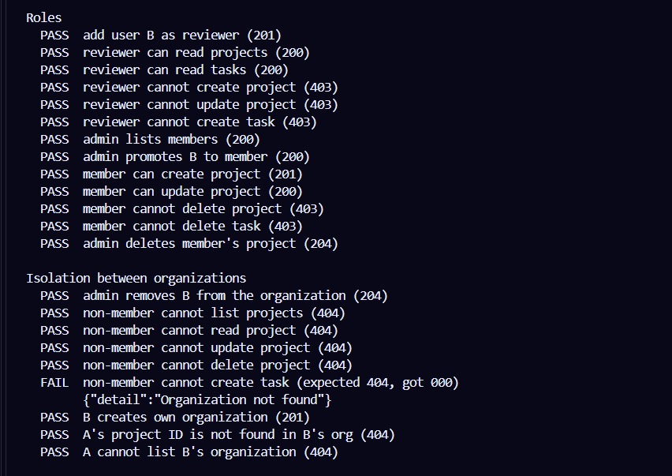

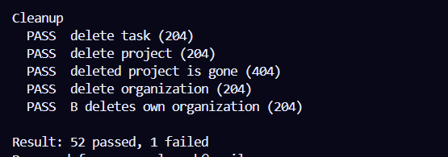

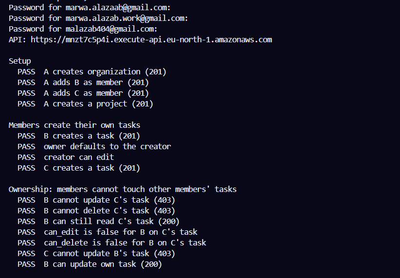

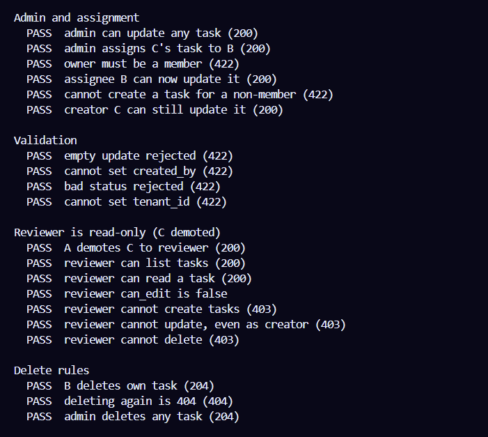

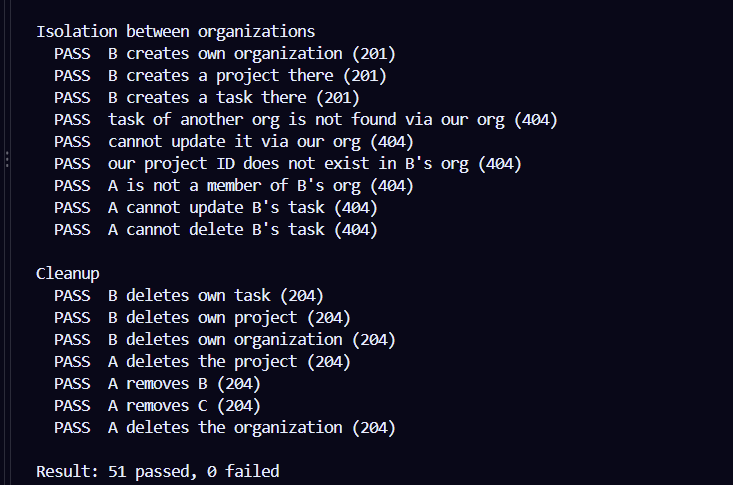