# AWS SAM Deployment: Cognito Authentication, FastAPI, and DynamoDB (Step #03 & Step #04)

---

## 1. Configure AWS Credentials

Before starting, make sure you have access to an AWS account and the necessary IAM permissions.

### 1.1 Create an AWS Access Key

1. Sign in to the [AWS Management Console](https://console.aws.amazon.com/).
2. Navigate to **IAM**.
3. Select the IAM user you are using.
4. Navigate to **Security credentials**.
5. Under **Access keys**, create a new access key.
6. Save the Access Key ID and Secret Access Key securely.

**Important:** Never share your access keys or commit them to GitHub. Prefer temporary credentials through IAM Identity Center or an appropriate role when possible.

### 1.2 Configure AWS CLI

Run the following command:

```bash
aws configure
```

Provide the requested information:

- AWS Access Key ID
- AWS Secret Access Key
- Default region name: `eu-north-1`
- Default output format: `json`

### 1.3 Verify AWS Credentials

Confirm that your credentials work:

```bash
aws sts get-caller-identity
```

This command should return information about the AWS account and IAM identity associated with your configured credentials.

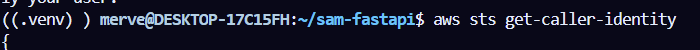

---

## 2. Configure Amazon Cognito

The first infrastructure update is to introduce Cognito resources into the SAM template.

### 2.1 Update template.yaml

Add the required Cognito resources to `template.yaml`.

These resources should include:

- Cognito User Pool
- Cognito User Pool Client
- Cognito User Groups (such as `admin`)
- Required outputs, including the User Pool ID and User Pool Client ID

The outputs will allow us to retrieve the generated resource IDs after deployment.

### 2.2 Validate, Build, and Deploy

After updating the template, run the following commands:

```bash
sam validate --lint
sam build
sam deploy --guided
```

During the guided deployment, use the following configuration:

| Prompt | Value |
|---|---|
| Stack Name | `sam-fastapi` |
| AWS Region | `eu-north-1` |
| Confirm changes before deploy | `Y` |
| Allow SAM CLI IAM role creation | `Y` |
| Disable rollback | `N` |
| FastApiFunction has no authentication. Is this okay? | `y` |
| Save arguments to configuration file | `Y` |
| SAM configuration file | `samconfig.toml` |
| SAM configuration environment | `default` |


### Deployment Screenshots

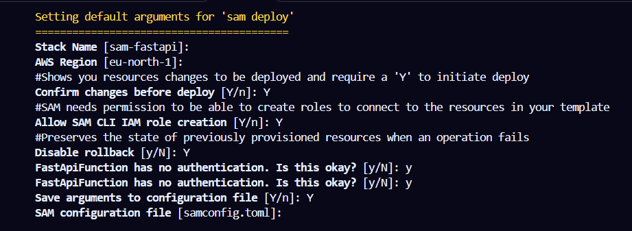

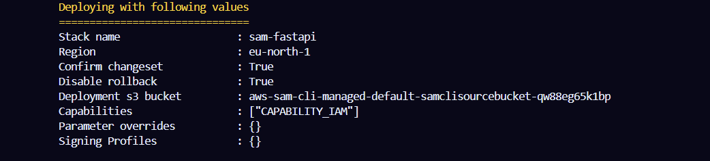

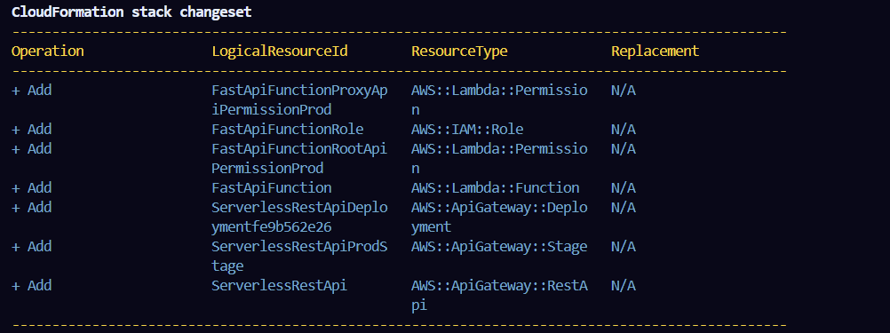

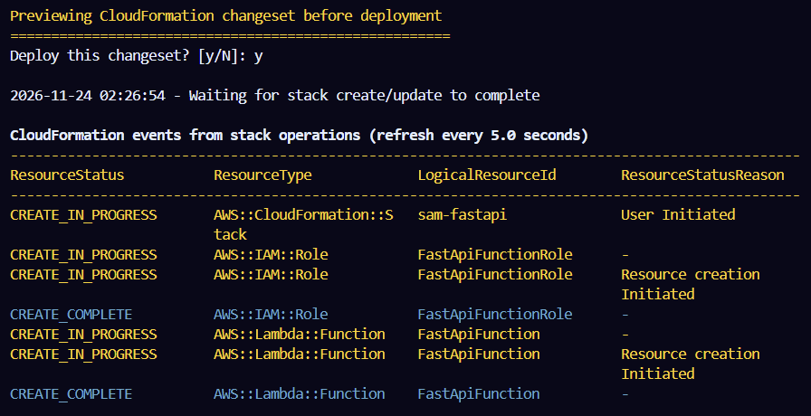


---

## 3. Retrieve Cognito Resource IDs

After a successful deployment, retrieve the Cognito User Pool ID and Client ID from the CloudFormation stack outputs.

Set the stack name:

```bash
STACK=sam-fastapi
```

Retrieve the User Pool ID:

```bash
POOL_ID=$(aws cloudformation describe-stacks \
  --stack-name "$STACK" \
  --query "Stacks[0].Outputs[?OutputKey=='UserPoolId'].OutputValue" \
  --output text)
```

Retrieve the User Pool Client ID:

```bash
CLIENT_ID=$(aws cloudformation describe-stacks \
  --stack-name "$STACK" \
  --query "Stacks[0].Outputs[?OutputKey=='UserPoolClientId'].OutputValue" \
  --output text)
```

Display both values:

```bash
echo "User Pool ID: $POOL_ID"
echo "Client ID: $CLIENT_ID"
```

These IDs are required for the subsequent Cognito operations.

---

## 4. Create a Test User in Cognito

Now that the User Pool has been deployed, we can create a test user and assign the user to the `admin` group.

### 4.1 Define User Credentials

```bash
EMAIL='you@example.com'
PASS='Str0ng-Passw0rd-123!'
```

Replace the email address with your preferred test email.

### 4.2 Create the User

```bash
aws cognito-idp admin-create-user \
  --user-pool-id "$POOL_ID" \
  --username "$EMAIL" \
  --user-attributes \
    Name=email,Value="$EMAIL" \
    Name=email_verified,Value=true \
    Name=custom:tenant_id,Value=tenant-001 \
  --message-action SUPPRESS
```

This command:

- Creates a new Cognito user.
- Sets the email address.
- Marks the email as verified.
- Assigns the custom tenant ID `tenant-001`.
- Suppresses the default invitation email.

Make sure that `custom:tenant_id` is defined in your Cognito User Pool schema.

### 4.3 Set a Permanent Password

```bash
aws cognito-idp admin-set-user-password \
  --user-pool-id "$POOL_ID" \
  --username "$EMAIL" \
  --password "$PASS" \
  --permanent
```

### 4.4 Add the User to the Admin Group

```bash
aws cognito-idp admin-add-user-to-group \
  --user-pool-id "$POOL_ID" \
  --username "$EMAIL" \
  --group-name admin
```

The test user is now created and assigned to the `admin` group.

### Test User Creation Screenshots

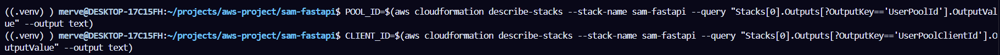

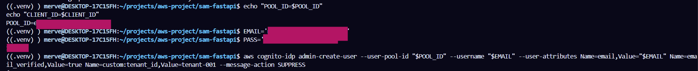

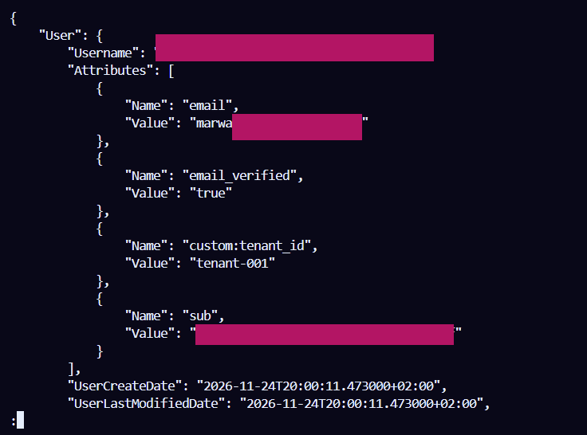

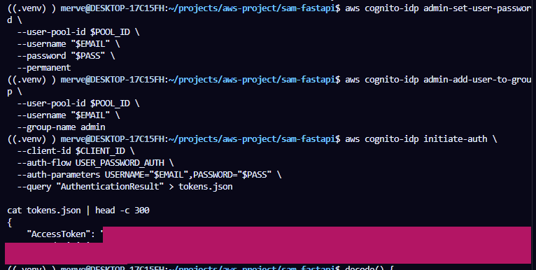

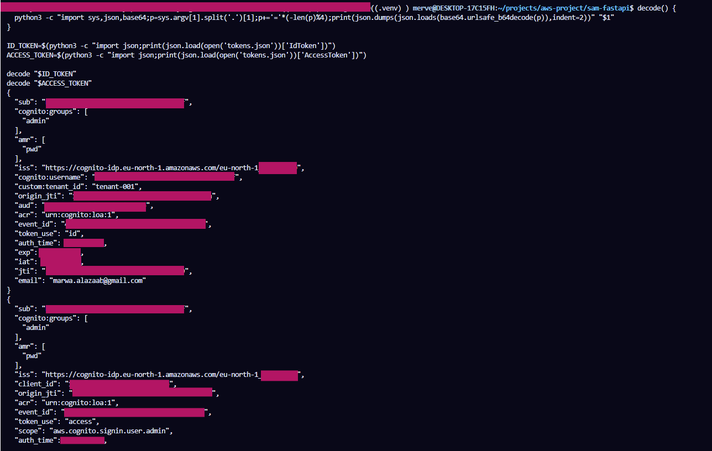

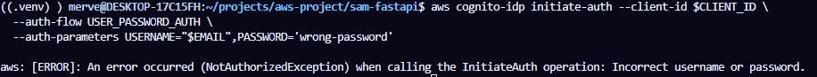

---

## 5. Authenticate the Test User and Retrieve JWT Tokens

We will now authenticate the test user using the Cognito User Pool Client.

### 5.1 Sign In

Run the following command:

```bash
aws cognito-idp initiate-auth \
  --client-id "$CLIENT_ID" \
  --auth-flow USER_PASSWORD_AUTH \
  --auth-parameters USERNAME="$EMAIL",PASSWORD="$PASS" \
  --query "AuthenticationResult" > tokens.json
```

This command authenticates the user and saves the authentication response to `tokens.json`.

The response contains:

- ID Token
- Access Token
- Refresh Token (when returned)
- Token expiration information

Inspect the beginning of the file:

```bash
head -c 300 tokens.json
```

### 5.2 Extract the Tokens

Retrieve the ID Token:

```bash
ID_TOKEN=$(python3 -c \
  "import json; print(json.load(open('tokens.json'))['IdToken'])")
```

Retrieve the Access Token:

```bash
ACCESS_TOKEN=$(python3 -c \
  "import json; print(json.load(open('tokens.json'))['AccessToken'])")
```

### 5.3 Decode and Inspect JWT Tokens

JWT tokens contain three parts:

1. Header
2. Payload
3. Signature

We can decode the payload to inspect the claims.

Create a helper function:

```bash
decode() {
  python3 -c "
import sys, json, base64
p = sys.argv[1].split('.')[1]
p += '=' * (-len(p) % 4)
print(json.dumps(
    json.loads(base64.urlsafe_b64decode(p)),
    indent=2
))
" "$1"
}
```

Decode the ID Token:

```bash
decode "$ID_TOKEN"
```

Decode the Access Token:

```bash
decode "$ACCESS_TOKEN"
```

Inspect the claims, especially:

- `sub`: Unique user identifier.
- `email`: User email.
- `cognito:username`: Cognito username.
- `cognito:groups`: Assigned groups.
- `custom:tenant_id`: Tenant identifier, when included in the token.
- `iss`: Token issuer.
- `exp`: Token expiration time.
- `token_use`: Identifies whether the token is an ID or access token.

**Important:** Decoding a JWT does not verify its signature. The API must validate the token using Cognito's signing keys and verify the issuer, audience/client ID, expiration, and token type.

---

## 6. Verify Authentication Failure

A successful authentication is not enough. We should also confirm that invalid credentials are rejected.

Try authenticating with an incorrect password:

```bash
aws cognito-idp initiate-auth \
  --client-id "$CLIENT_ID" \
  --auth-flow USER_PASSWORD_AUTH \
  --auth-parameters USERNAME="$EMAIL",PASSWORD='wrong-password'
```

Expected result:

The authentication request should fail with an error such as `NotAuthorizedException`.

This confirms that Cognito is enforcing password authentication.

---

## 7. Upgrade the API Architecture and Add DynamoDB

After validating Cognito authentication, we can extend the application architecture.

The next step is to integrate DynamoDB and configure JWT authorization at the API Gateway level.

### 7.1 Replace REST API with HTTP API

Update `template.yaml` to replace the existing REST API with an API Gateway HTTP API.

Why use HTTP API?

- Lower cost compared with REST API in typical configurations.
- Simpler configuration.
- Native JWT authorizer support.
- Suitable for lightweight serverless applications.

### 7.2 Configure a JWT Authorizer

Configure an API Gateway JWT authorizer using the Cognito User Pool.

The authorizer should include:

- **Issuer:** Cognito User Pool issuer URL.
- **Audience:** Cognito User Pool Client ID.
- **Identity source:** Authorization header.

The Authorization header will use the following format:

```http
Authorization: Bearer <JWT_TOKEN>
```

Attach the JWT authorizer to the protected API routes.

For example:

- `/health`: Public endpoint.
- `/hello`: Protected endpoint requiring a valid JWT.

**Important:** API Gateway's JWT authorizer validates the JWT before forwarding the request to FastAPI. Make sure the token type and claims are appropriate for your authorization configuration.

### 7.3 Define the DynamoDB Table

Add a DynamoDB table resource to `template.yaml`.

Define:

- Table name.
- Partition key.
- Attribute definitions.
- Billing mode.
- Any additional indexes required by the application.

For a serverless application, on-demand billing (`PAY_PER_REQUEST`) is a convenient starting point because it avoids provisioning read and write capacity in advance.

### 7.4 Update IAM Permissions

Update the Lambda execution role with the necessary DynamoDB permissions.

Grant only the operations the application requires, such as:

- `dynamodb:GetItem`
- `dynamodb:PutItem`
- `dynamodb:UpdateItem`
- `dynamodb:Query`
- `dynamodb:DeleteItem`

Restrict permissions to the specific table ARN whenever possible.

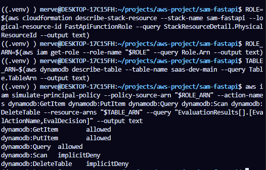

### 7.5 Update app.py to Use FastAPI

Update `app.py` to replace the raw API implementation with FastAPI.

The application should:

- Initialize the FastAPI application.
- Define the required API endpoints.
- Integrate with DynamoDB.
- Handle incoming requests.
- Return appropriate HTTP responses.

Make sure the Lambda handler and SAM configuration are compatible with the FastAPI integration, for example through an appropriate ASGI adapter.

### 7.6 Validate, Build, and Deploy Again

After completing the infrastructure and application updates, deploy the new architecture:

```bash
sam validate --lint
sam build
sam deploy
```

The deployed stack should now contain:

- Cognito User Pool.
- Cognito User Pool Client.
- API Gateway HTTP API.
- JWT Authorizer.
- Lambda function running FastAPI.
- DynamoDB table.
- Required IAM permissions.

---

## 8. Test the Deployed API

Once deployment is complete, retrieve the API URL from CloudFormation.

### 8.1 Retrieve the API URL

```bash
API_URL=$(aws cloudformation describe-stacks \
  --stack-name sam-fastapi \
  --query "Stacks[0].Outputs[?OutputKey=='ApiUrl'].OutputValue" \
  --output text)
```

Display the URL:

```bash
echo "$API_URL"
```

### 8.2 Test the Health Endpoint

```bash
curl -i "${API_URL}health"
```

Expected result:

The API should return a successful HTTP response if the health endpoint is configured correctly.

### 8.3 Test the Hello Endpoint Without Authentication

```bash
curl -i "${API_URL}hello"
```

If `/hello` is protected by the JWT authorizer, the request should be rejected because no authentication token was provided.

### 8.4 Test the Hello Endpoint With a Valid Token

```bash
curl -i \
  -H "Authorization: Bearer $ID_TOKEN" \
  "${API_URL}hello"
```

Expected result:

The API should accept the request and return the response defined by the FastAPI endpoint.

### 8.5 Test the API With an Invalid Token

```bash
curl -i \
  -H "Authorization: Bearer garbage" \
  "${API_URL}hello"
```

Expected result:

The request should be rejected with an HTTP `401 Unauthorized` response.

These tests confirm that the API Gateway JWT authorizer is enforcing authentication.

---

## 9. DynamoDB Creation and Testing

The following screenshots document the DynamoDB creation and testing process.

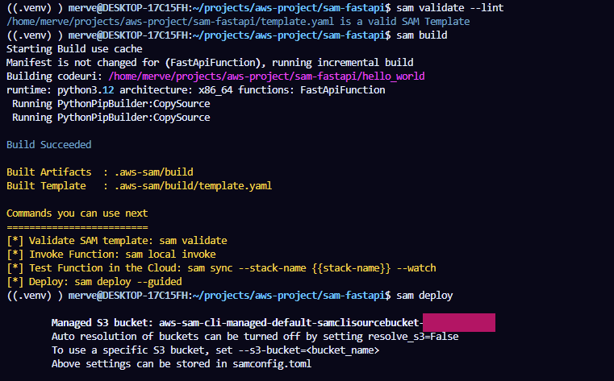

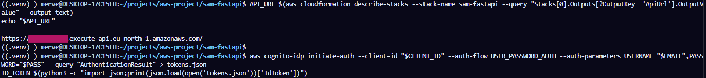

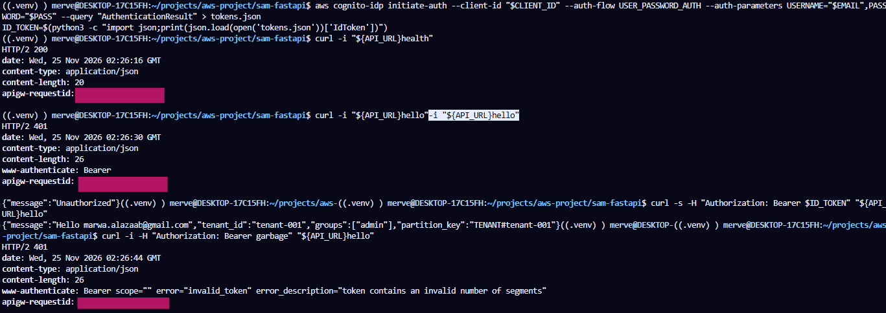

Make sure to verify that:

- The DynamoDB table was successfully created.
- The Lambda function has the required IAM permissions.
- The application can communicate with DynamoDB.
- Data can be written and retrieved successfully.

---

## 10. Monitor AWS Service Consumption and Costs

As a final step, monitor your AWS resource consumption to avoid unexpected charges.

Use the AWS Billing and Cost Management dashboard and AWS Cost Explorer to review your service usage.

You can also use the AWS Overview dashboard to inspect your deployed services and their associated costs.

Pay particular attention to:

- AWS Lambda invocations and execution duration.
- API Gateway HTTP API requests.
- DynamoDB read and write operations.
- Cognito usage.
- CloudWatch logs and storage.
- CloudFormation and other supporting resources.

**Cost consideration:** The cost of a scan or operation depends on the AWS service and the type of scan being performed. If the scan you are referring to costs approximately `$0.01`, verify that amount against the current AWS pricing and your actual usage.

It is recommended to monitor AWS costs regularly, especially when experimenting with new services.

---

## 11. Final Architecture

At the end of this implementation, the application should follow this architecture:

1. **Amazon Cognito:** Manages user registration and authentication.
2. **API Gateway HTTP API:** Exposes the application endpoints.
3. **JWT Authorizer:** Validates authentication tokens before requests reach the backend.
4. **AWS Lambda:** Executes the FastAPI application.
5. **Amazon DynamoDB:** Stores application data.
6. **AWS IAM:** Controls permissions between AWS services.

### Final Request Flow

```text
             Client
                |
                v
        Amazon Cognito
                |
          JWT Token
                |
                v
        API Gateway HTTP API
                |
                v
          JWT Authorizer
                |
         Token Valid?
                |
          +-----+-----+
          |           |
         Yes          No
          |           |
          v           v
      AWS Lambda     401
       FastAPI
          |
          v
       DynamoDB
          |
          v
       Response
```

